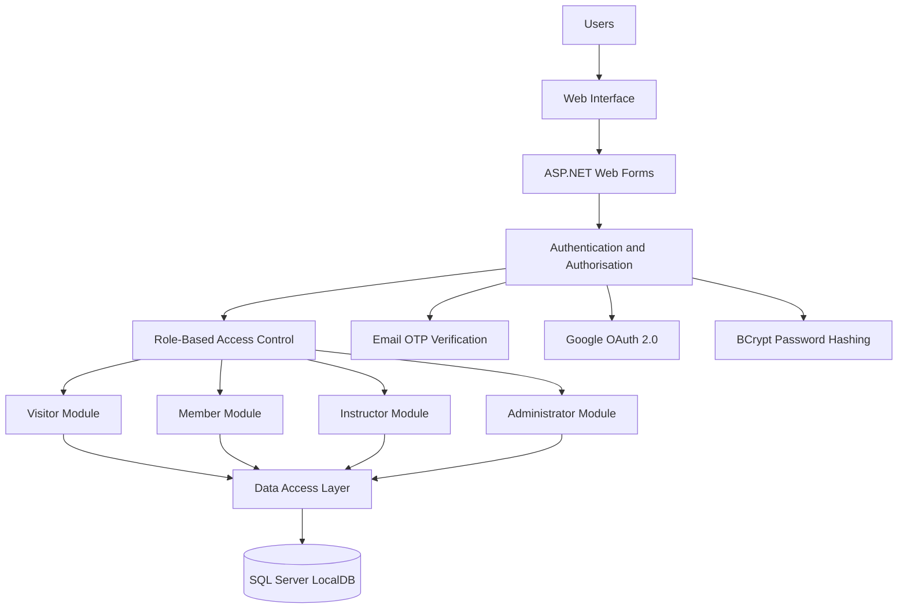

# Aidcademy 🩺

**An interactive first-aid e-learning platform built with secure web development practices.**


## 📖 Overview

Aidcademy is a web-based interactive learning platform designed to make first-aid education accessible, engaging, and practical. The platform provides structured lessons, multimedia learning materials, quizzes, and interactive emergency response simulations to help users develop fundamental first-aid knowledge.

The application incorporates gamification through experience points (XP), daily learning streaks, and leaderboards to encourage continuous learning.

Developed as a university group project at Asia Pacific University (APU), Aidcademy demonstrates the integration of full-stack web development, relational database management, and security-focused application design.

## ✨ Key Features

### Learning and Gamification

- Structured first-aid courses and multimedia lessons.
- Interactive quizzes with automated scoring.
- Learning progress tracking and personalised dashboards.
- Experience points (XP), daily streaks, and competitive leaderboards.
- Free lesson previews for unregistered visitors.
- Built-in Q&A system for communication between members and instructors.

### Interactive First-Aid Simulations

The platform includes five interactive emergency response simulations:

| Simulation | Description |
| --- | --- |
| D.R.S.A.B.C.D. Action Plan | Drag-and-drop emergency response sequence training. |
| CPR & AED | Interactive CPR rhythm training. |
| Choking Emergencies | Choking response and protocol training. |
| Circulatory Disorders | Bleeding and emergency triage simulation. |
| Medical Emergencies | Stroke F.A.S.T. recognition training. |

### Content Management

- Instructor dashboard for creating, editing, and managing learning materials.
- Rich-text lesson editor powered by Quill.
- Quiz creation and management.
- Configurable interactive simulations.
- Administrator-controlled content approval workflow.
- User management and site activity monitoring.

## 🔐 Security Features

Security was an important consideration throughout the development of Aidcademy. The platform incorporates multiple security mechanisms to protect user accounts, restrict unauthorised access, and reduce common web application security risks.

| Security Feature | Implementation |
| --- | --- |
| Role-Based Access Control (RBAC) | Restricts access to application resources and functionalities according to user roles. |
| Password Hashing | Uses BCrypt to securely hash user passwords before storing them in the database. |
| Password Complexity Validation | Enforces password requirements during account registration and password changes. |
| Email-Based OTP Verification | Provides time-limited one-time passwords for account verification and authentication. |
| Google OAuth 2.0 | Supports authentication using Google accounts. |
| CSRF Protection | Uses OAuth state validation and HttpOnly cookies to protect the Google authentication flow against cross-site request forgery. |
| Session Management | Manages authenticated user sessions and restricts access to protected pages. |
| Input Validation | Validates user-submitted data before processing and database operations. |
| SQL Injection Prevention | Uses parameterized SQL queries to reduce SQL injection risks. |
| Password Recovery | Implements an OTP-based verification process for password resets. |
| Account Management | Allows administrators to manage user account status and access. |

### Security Design Highlights

- Passwords are stored as BCrypt hashes rather than plaintext.
- Legacy password hashes are upgraded to BCrypt upon successful verification.
- Email-based OTP codes have a limited validity period and are used during local authentication workflows.
- Authentication and authorisation checks are performed before granting access to protected functionalities.
- Parameterized database queries separate user input from SQL statements.
- Google OAuth authentication uses a randomly generated state token to mitigate CSRF risks.
- Instructor-submitted learning content requires administrator approval before publication.

These mechanisms demonstrate the practical application of secure coding principles and defence-in-depth within a web application.

## 👥 User Roles

Aidcademy supports four distinct user roles.

| Role | Permissions and Functionalities |
| --- | --- |
| Visitor | Browse public content, preview courses, access a free lesson, and register an account. |
| Member | Enrol in courses, complete lessons and quizzes, track progress, earn XP, and submit questions. |
| Instructor | Create and manage learning content, quizzes, and simulations, and respond to member questions. |
| Administrator | Manage user accounts, approve or reject learning content, monitor site activity, and review feedback. |

The role-based architecture ensures that privileged operations are restricted to the appropriate users.

## 🛠️ Technology Stack

### Frontend

- HTML5
- CSS3
- JavaScript
- Bootstrap 5
- Quill Rich Text Editor
- Font Awesome

### Backend

- C#
- ASP.NET Web Forms
- .NET Framework
- ADO.NET

### Database

- Microsoft SQL Server LocalDB

### Authentication and Security

- BCrypt.Net
- Google OAuth 2.0
- Email-based OTP verification
- ASP.NET session management
- Parameterized SQL queries

### Development Tools

- Visual Studio
- Git
- GitHub

## 🏗️ System Architecture

Aidcademy follows a web application architecture that separates the user interface, application logic, and database operations.



### Database Design

The relational database manages information related to:

- User accounts and profiles
- OTP codes and password reset tokens
- Courses and lessons
- Course enrolments and learning progress
- Quizzes and quiz results
- Leaderboard scores and daily streaks
- Interactive lesson simulations
- Member questions and instructor responses
- Lesson ratings and feedback
- Website traffic records

SQL transactions are used for related database operations where necessary to maintain data consistency.

## 🚀 Getting Started

### Prerequisites

Ensure that the following software is installed:

- Visual Studio with ASP.NET and web development support
- A compatible .NET Framework version
- Microsoft SQL Server Express LocalDB
- Git
- A modern web browser

### 1. Clone the Repository

```bash
git clone https://github.com/YingZhe8737/Aidcademy.git
cd Aidcademy
```

### 2. Open the Project

Open the project or solution file using Visual Studio.

Restore any required NuGet packages before building the application.

### 3. Configure the Database

Configure Microsoft SQL Server LocalDB and ensure that the required Aidcademy database and tables are available.

Update the database connection string in the application configuration to match your local SQL Server instance.

### 4. Configure Authentication Services

To enable Google authentication and email-based OTP verification, configure the appropriate credentials for:

- Google OAuth 2.0 Client ID
- Google OAuth 2.0 Client Secret
- Google OAuth redirect URI
- Email or SMTP service credentials

Keep all sensitive credentials in local configuration and do not commit them to the repository.

### 5. Run the Application

Build the project in Visual Studio and run it using the configured local development server.

Open the generated localhost URL in your browser to access Aidcademy.

> **Note:** The application was developed as a local academic prototype. Additional configuration may be required depending on your development environment.

## 🧪 Testing

The project includes functional testing of the following areas:

- User registration and login.
- OTP verification.
- Password validation and recovery.
- Role-based access restrictions.
- Course enrolment and learning progress.
- Quiz submission and scoring.
- Instructor content creation and management.
- Administrator content approval.
- Form validation.
- Cross-browser compatibility.

## 📚 Learning Outcomes

Through the development of Aidcademy, the team gained practical experience in:

- Full-stack web application development.
- Secure authentication and authorisation mechanisms.
- Password hashing and credential protection.
- Prevention of common web application vulnerabilities.
- Relational database design and SQL integration.
- Session management and access control.
- Interactive frontend development.
- Version control and collaborative software development.
- Project planning, teamwork, and technical documentation.

## 🔮 Future Improvements

Potential enhancements for future development include:

- Production deployment with HTTPS configuration.
- Additional application security testing and vulnerability assessments.
- Stronger session and cookie security configurations.
- Centralised security logging and monitoring.
- Additional first-aid courses and interactive simulations.
- Certificate generation upon course completion.
- Mobile application support.
- Multilingual learning materials.
- Enhanced discussion and notification features.

## ⚠️ Disclaimer

Aidcademy was developed for academic and educational purposes.

The first-aid materials and simulations are intended to support fundamental learning and awareness. They are not a substitute for professional medical advice, certified first-aid training, or emergency medical services.

Although the application incorporates multiple security mechanisms, it is an academic prototype and has not undergone a comprehensive production-level security assessment.

---

Developed with ❤️ by Group 36, Asia Pacific University.

**Learn first aid. Build confidence. Be prepared.**
